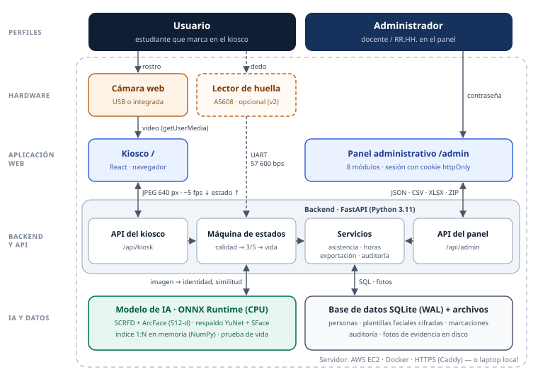

# Asistencia Biométrica

**Proyecto final · Introducción a Cognitive Computing (EL3302)**
Kiosco web de entrada y salida con reconocimiento facial, prueba de vida y panel administrativo.
Toda la inteligencia artificial corre en la propia laptop: las imágenes y los datos biométricos no
salen del equipo.

| | |
|---|---|
| **Integrantes** | Mateo Llallire Meza · Tomás Laura |
| **Docente** | Jaime Farfán Madariaga |
| **Informe (PDF)** | [`docs/informe/Informe_Asistencia_Biometrica.pdf`](docs/informe/Informe_Asistencia_Biometrica.pdf) |

## Cumplimiento de los lineamientos

| Requisito | Cómo se cumple | Dónde está en el código |
|---|---|---|
| Perfil **Usuario** | El estudiante marca con su rostro, supera la prueba de vida, ve su resultado y su resumen «Tu semana» | `frontend/src/kiosk/`, `backend/app/kiosk/session.py`, `backend/app/services/personal_summary.py` |
| Perfil **Administrador** | Panel con inicio de sesión: personas, enrolamiento, marcaciones, horas, exportar, configuración, auditoría | `frontend/src/admin/`, `backend/app/api/admin_*.py` |
| **Aplicación web** | React + TypeScript; kiosco en `/` y panel en `/admin`, adaptable hasta 390 px | `frontend/` |
| **Hardware** | Cámara web (≈5 imágenes/s por HTTP local) y lector de huella AS608 por UART (opcional, v2) | `frontend/src/lib/useCamera.ts`, `backend/app/fingerprint/` |
| **Inteligencia Artificial** | Detección SCRFD + reconocimiento ArcFace (512-d), identificación 1:N con consenso 3/5, prueba de vida por giro de cabeza, calibración FAR/FRR | `backend/app/face/`, `backend/app/services/calibration.py` |
| **Arquitectura** | Diagrama abajo y en la sección 9 del informe | `docs/informe/arquitectura.svg` |

## Arquitectura



Flujo de una marcación: cámara → kiosco (navegador) → `POST /api/kiosk/sessions/{id}/frames` →
máquina de estados (calidad → identificación 1:N → consenso 3 de 5 → anti-rebote → prueba de vida)
→ registro en SQLite → resultado y «Tu semana» de vuelta en el kiosco.

## Puesta en marcha (Windows, PowerShell)

Requisitos: [uv](https://docs.astral.sh/uv/) (`winget install --id=astral-sh.uv -e`), Node.js 20 o
superior y Chrome o Edge. Se necesita internet solo durante la instalación.

```powershell
cd backend
uv python install 3.11
uv sync --frozen
uv run python -m app.cli env-init          # crea .env con la clave de cifrado y la contraseña del panel
uv run python -m app.cli download-models   # descarga los modelos ONNX (~300 MB)
uv run python -m app.cli init-db
uv run python -m app.cli check-engine      # debe responder ready: true

cd ..\frontend
npm.cmd ci
npm.cmd run build

cd ..\backend
uv run python -m app                       # http://localhost:8000 (kiosco) y /admin (panel)
```

La contraseña del panel está en `ADMIN_PASSWORD` dentro de `.env`. Para ver los reportes con datos
de ejemplo: `uv run python -m app.cli seed-demo`. Guía de instalación y ensayo de la demo:
[`docs/WINDOWS-DEMO.md`](docs/WINDOWS-DEMO.md). En macOS: `scripts/setup.sh` y `scripts/start.sh`.

## Pruebas

```powershell
cd backend
uv run pytest -q                     # 79 pruebas (reglas, kiosco, API, exportaciones, motores reales)
uv run python scripts/smoke_api.py   # 30 verificaciones de integración con InsightFace y SFace
cd ..\frontend
npm.cmd run typecheck; npm.cmd run lint
npx.cmd playwright test              # 6 pruebas end-to-end con cámara simulada
```

Último resultado (24/11/2026): 79/79, 30/30 y 6/6.

## Estructura

```
backend/    FastAPI: API, máquina de estados del kiosco, motores faciales, huella, servicios, CLI, pruebas
frontend/   React + Vite + Tailwind: kiosco, panel administrativo y pruebas E2E (Playwright)
docs/       informe/ (PDF, HTML fuente y diagrama), GUIA-DE-USO.md, WINDOWS-DEMO.md,
            REVISION-2026-10-31.md, SPEC.md, DESIGN.md
scripts/    instalación, arranque y verificación (macOS / Git Bash)
```

## Privacidad y licencias

- No se versionan `.env`, la base de datos, las fotos ni los modelos (`.gitignore`).
- Las plantillas faciales se guardan cifradas (Fernet). El enrolamiento exige consentimiento, y el
  panel permite borrar los datos biométricos de una persona.
- Los modelos preentrenados de InsightFace (`buffalo_l`) son solo para uso no comercial y de
  investigación, lo que vale para este proyecto académico. Para uso comercial existe el motor `sface`
  (Apache-2.0).

El manual completo del sistema (configuración, calibración, huella AS608, solución de problemas)
está en [`docs/GUIA-DE-USO.md`](docs/GUIA-DE-USO.md).
